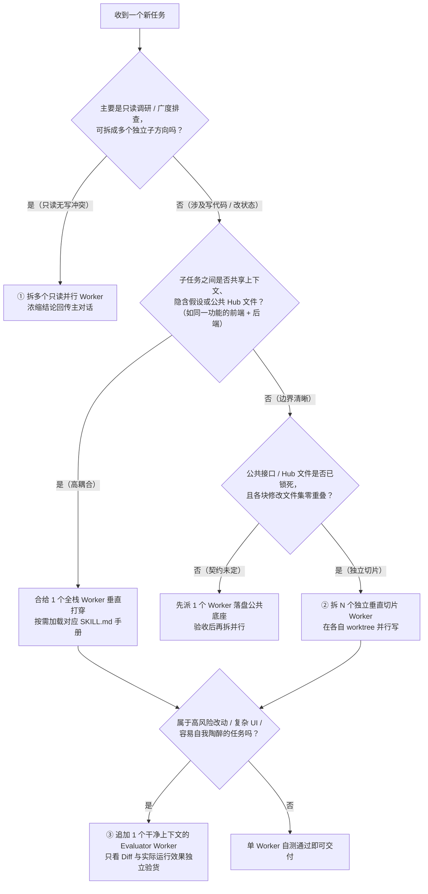

> 凡治众如治寡，分数是也。——《孙子兵法·兵势篇》（[原文](https://zh.wikisource.org/zh-hans/孫子兵法)）

> **给 AI 派活最容易踩的两个坑，一是照搬人类公司的“前端岗 + 后端岗”把同一道菜劈给两个失忆的厨师，二是一口气建十几个常驻 Bot 把自己变成批奏折机器。我的做法是：按上下文分 Worker（同一个功能的全栈活交给 1 个临时 Worker 垂直打穿），按职能挂 Skill（干到哪一步就翻哪本 `SKILL.md` 手册）；只在只读调研、零重叠切片和独立验货 3 种场景拆多 Worker；日常保持 1 个总管 Bot + 活跃待办上限（WIP ≤ 3–4），只有撞上权限隔离、高频静默巡检或记忆打架 3 条硬门槛时才建新 Bot。**

## 当 AI 变成「奏折制造机」

上了多 Agent 编排工作台（像我最近主力在用的 [Orca](https://orca.dev/docs/bots)）之后，最先撞上的墙根本不是 AI 不会干活，而是**人批不过来**。

我给自己的总管 Bot `SuperGeo` 接上本机的几个项目仓库后，不到 24 小时，它就在后台拉起了 29 条待办事项（Items）。社区里还有更夸张的真实例子：开发者 Danilo（[@ilseccoz](https://x.com/ilseccoz/status/2123863848906022973)）在 X 上晒过一套叫“Regia（控制室）”的个人多 Bot 架构——顶上是他自己，只和唯一的总管 Bot `HAL` 说话；`HAL` 底下挂着 **10 个按项目和领域拆分的子 Bot**（写双语文章的 `Parrot`、管健身项目的 `Gymbro`、管代码的 `Team1` 等等），再往下是干活的 Workers。

架构图看着很爽，但仔细看他晒出来的控制室实时面板，顶上赫然挂着一行字：**`33 aspettano te`（33 个事项正在等你批阅）**。

我看到那张图时直接笑出声，因为我也[在推上吐槽过](https://x.com/geoqiao/status/2123870193017655458)一模一样的痛点：一不小心养了一屋子分身，一天吐出二三十个 `waiting for you`。本来请 AI 是为了省脑子，结果人沦为了疲于奔命的“批奏折机器”——当待批阅事项超过单次心智带宽时，人要么被满屏红点逼出焦虑症，要么看都不看开始盲点同意（Approval Fatigue）。

为什么分身越多反而越累、代码还越容易写劈叉？顺着这几天的折腾，我把 2024–2026 年的 16 篇多 Agent 论文、一线团队工程报告和 Orca 的本机源码完整扒了一遍，发现问题出在两个最底层的分工假设上。

## 一、为什么人类公司按“前端 / 后端 / SEO”分岗位，但给 AI 派活绝不该这么拆？

刚开始玩多 Agent 的人（包括早期的 [MetaGPT](https://arxiv.org/abs/2308.00352)、[ChatDev](https://arxiv.org/abs/2307.07924) 这类把大模型包装成“虚拟软件公司”的框架），特别喜欢照抄人类公司的部门花名册：拆一个产品经理 Agent、一个前端 Agent、一个后端 Agent、一个测试 Agent，让它们像流水线一样传话干活。

这套分法在人类公司里天经地义，但搬到 AI 身上却是典型的反模式。因为**人类和 AI 卡脖子的地方完全相反**：

- **人类的瓶颈在“一个脑子装不下所有手艺”**：一个前端工程师很难同时精通 Rust 并发、PostgreSQL 调优、SEO 收录和视频剪辑。人类是因为单人技能树装不下，才不得不按**职能（手艺）**拆成前端岗和后端岗，然后忍受天天拉群开会、对接口文档的沟通损耗。
- **AI 的瓶颈根本不在手艺，而在“跨窗口失忆”**：现代前沿大模型天生肚子里就装了全工种的基础手艺——它同时懂 SQL、TypeScript、React、Python 和 CSS，是个天生的**全栈通才**。但它的软肋在于**上下文窗口（Context Window）就是它的记忆边界**：每当你新开一个 Agent 窗口，对它来说就是换了一个不知道前因后果的失忆新人。

用炒菜打个比方就明白了：

> **把同一个功能按“前端 Worker + 后端 Worker”劈成两半，就像让一个厨师蒙着眼睛切菜、另一个厨师蒙着眼睛调酱，两个人中间只靠门缝塞小纸条——只要纸条上漏写一句“今天放了咸酱油”，两盘半成品一合锅，炒出来的菜就咸得没法吃。**

写代码时，每写一行其实都在做大量“没写进文档的隐含决定”（空值怎么兜底、错误码叫什么、状态机怎么流转）。[Cognition（Devin 团队）在 2025 年的工程复盘](https://cognition.com/blog/dont-build-multi-agents)里把这总结为两条铁律：**“共享完整上下文轨迹（Share Full Traces）”** 和 **“行动自带隐含决策（Actions Carry Implicit Decisions）”**——如果让两个并行 Agent 分别写 Flappy Bird 的小鸟和背景，写着写着两边的坐标、物理假设和数据结构必然撞车。

2025–2026 年的三项硬核实证研究，用数据给这种“按岗位硬拆”判了死刑：

| 研究来源 | 实验规模与设计 | 核心实测结果 | 说人话的结论 |
| --- | --- | --- | --- |
| **Stanford & SAP Labs** [CooperBench (2026.01)](https://arxiv.org/abs/2601.13295) | 12 个真实开源库、652 个任务；对比“2 个 Agent 合作写两个有交集的功能”与“1 个 Agent 顺着全写完” | 双 Agent 合作成功率比单 Agent 独自写完**平均暴跌约 30%**（同样沟通限制下人类搭档成功率约 90%，双 LLM 搭档跌到约 30%） | **协作诅咒**：哪怕事先聊好接口，写着写着一方改了结构也不通知对方（承诺漂移），各自脑补必然翻车 |
| **UC Berkeley** [MAST (NeurIPS 2025)](https://arxiv.org/abs/2503.13657) | 标注 MetaGPT、ChatDev 等 7 个主流框架的 1,600+ 条执行轨迹，归纳 14 种死因 | **41.8%** 死于任务拆分与角色边界不当，**36.9%** 死于跨 Agent 交接丢上下文与对齐失效（合计 **约 79%**） | 绝大多数多 Agent 翻车不是因为模型写不出代码，而是死在“瞎拆分 + 传话筒失真” |
| **Google DeepMind & MIT** [Scaling Agent Systems (2025.12/2026.04)](https://arxiv.org/abs/2512.08296) | 6 个基准、5 种拓扑架构、260 组受控实验，统一工具与算力预算 | 可自然拆解的并行分析最高提效 **+80.8%**；但强依赖的顺序与工具密集型任务，多 Agent 性能**暴跌 -39% 到 -70%**，无中心校验时错误放大 **17.2 倍** | 步步相扣的写代码任务硬上多 Agent，不仅烧钱还会大幅拉低成功率 |

## 二、黄金公式：上下文决定“派给谁（Worker）”，职能决定“发哪本手册（Skill）”

看到这里你肯定会问：如果不按前端、后端、SEO 拆人，那遇到专门领域的手艺活，怎么保证 AI 不写出过时的野路子代码？

答案是把**“派给谁干（Worker 边界）”**和**“按什么专业标准干（Skill 手册）”**彻底分开——这也是我们今天梳理出的黄金公式：

> **按上下文（Context）分 Worker，按职能（Function）挂 Skill。**

### 1. 上下文决定 Worker 边界：1 个全栈厨师端到端炒完一整道菜

凡是需要共享同一套业务前因后果、数据结构、公共枢纽文件（Hub Files，比如全局配置、数据库 Schema、公共类型定义）和隐含假设的活，默认交给 **1 个全栈 Worker**，从数据库、后端接口、前端界面到联调测试一口气**垂直打穿**（对应软件工程里的[垂直切片架构 Vertical Slice Architecture](https://www.jimmybogard.com/vertical-slice-architecture/)）。

2026 年 5 月 UT Austin 与牛津大学发表的 **[Co-Coder](https://arxiv.org/abs/2606.00953)** 论文，几乎就是这个直觉的数学证明。他们把多 Agent 派工建模为代码依赖图上的社区发现问题：

1. 先用静态分析圈出谁都依赖的 **“枢纽文件（Hub Files）”**，绝不让多个并行子任务同时去碰它们；
2. 再用基于信息流的 Infomap 算法，把**高内聚、互相紧密依赖（需要看同一批上下文）的文件簇打包划给同一个 Agent**；
3. 只对真正低耦合的独立簇做并行调度。

在 DevEval 和 CodeProjectEval 的 28 个真实仓库任务上，对比纯顺序单 Agent、按文件盲目并行、以及 Claude Code with Agent Teams，**按上下文内聚度聚合的 Co-Coder 让任务通过率最高提升 14.0%，端到端耗时加快 2.10 倍，API 成本反而下降最高 35%**——而且项目内部的代码依赖越密集，合在一个上下文里干的收益就越大。

### 2. 职能决定 Skill 手册：做到哪一步，就从兜里掏出哪本菜谱

既然活全交给了那 1 个全栈 Worker，专业手艺怎么补？靠 **`SKILL.md`（按需加载的操作手册）**。

大模型虽然全栈都懂，但训练权重里的知识可能滞后，也不懂你项目的私房规矩。这时候不需要为前端或 SEO 单独招一个 Agent，只需要给正在干活的全栈 Worker 配齐对应的 Skill：

- 当它写到网页弹窗、表格和暗色模式时，翻开 `modern-web-guidance` 手册，核对最新的 HTML/CSS 实践；
- 当它顺手改到 Chrome 伴侣扩展时，翻开 `chrome-extensions` 手册，照着 Manifest V3 和 Service Worker 规范写；
- 当功能上线、要去核对收录与外链目录时，它再翻开 `seo-diagnosis` 手册逐项打勾。

**干活的始终是那 1 个知道全部前因后果的人，只是切菜时翻《刀工手册》、调酱时翻《味型表》。** 平时不翻开时 `SKILL.md` 占 0 个 Token，翻开时立刻补齐专家级规范，既不会把一道菜撕成两半，也不会漏掉专业细节。

## 三、那什么时候才该拆多个 Worker？（3 个正向场景）

“默认 1 个全栈 Worker 垂直打穿”，不等于永远只开一个窗口。当任务满足**“不需要多个写手实时互改同一份状态”**时，有 3 个场景拆给多个 Worker 的收益非常显著：

### 1. 读可以散开，写尽量收口（广度只读并行调研）

让 3 个 Worker 同时改同一份耦合代码会打架，但让 3 个 Worker 分头去查 3 个方向的论文、扒 5 家竞品的定价、或者分别排查代码库里 3 个无关子系统的现状，它们**只读不写**，零冲突，还能避免海量网页把主对话的上下文塞爆（Context Rot）。

- [Anthropic 多 Agent 调研系统报告（2025.06）](https://www.anthropic.com/research/multi-agent-research-system)实测：在宽范围深度调研上，Opus 领队 + Sonnet 并行子 Agent 比单 Opus **大幅提效 +90.2%**（代价是 Token 消耗约为单 Agent 的 3.7 倍、普通对话的 15 倍）。值得注意的是，Anthropic 在同一篇报告里直接点名了写代码的区别：*“需要所有 Agent 共享同一上下文的领域目前不适合多 Agent——比如大多数编码任务真正可并行的子任务远少于调研。”*
- [Cognition 2026 年 4 月的生产复盘](https://cognition.com/blog/multi-agents-working)也给出了完全一致的结论：多写手并行蜂群在生产环境依然基本不可用，真正跑通的模式是 **“多脑并行提供情报与审阅，单手独占写操作（Single-Threaded Writes）”**。

### 2. 真正互不打架的独立垂直切片（公共契约已锁死，修改文件集零重叠）

当一个大需求已经先由 1 个 Worker 把公共底座（共享 Schema、接口契约、Hub 文件）落盘锁死，剩下的子块彼此**修改的文件集完全零重叠**（比如一边开发“导出 PDF 模块”、一边开发“快捷键设置面板”，或者同时给项目 A 改 SEO、给项目 B 修 Bug），就可以参照 Co-Coder 的做法，开多个独立的 Git worktree 并行推进。

注意：**每个并行 Worker 手里拿的依然是一个前后端完整的垂直切片**，绝不是按前后端横着切。

### 3. 写与验分离：故意不共享上下文的独立挑刺

这是最反直觉、实战里却最救命的一条：**写代码的人千万别拆成前后端两半，但“写代码的人（Generator）”和“验收挑刺的人（Evaluator / Reviewer）”非常值得拆开。**

为什么这里反而要**故意隔离上下文**？[Anthropic 在 2026 年 3 月的长程应用 Harness 报告](https://www.anthropic.com/research/harness-design-long-running-apps)里指出了大模型的 **“自我评估陷阱（Self-Evaluation Trap）”**：让同一个 Agent 写完代码再自己检查，它脑子里装满了刚才写代码时的良苦用心和推理妥协，会陷入严重的“自我陶醉”，对着半成品也自信满满地汇报“测试通过、完美运行”。

破局办法就是**换一个没有沉没成本的干净脑子**：

- **Worker A（写手）** 端到端写完整个功能并自测；
- **Worker B（独立验货员）** 用全新的干净上下文启动，不看 Worker A 啰嗦的心路历程，只看最终的 Git Diff、跑验收命令、或者用 Playwright 浏览器真去点一遍页面（就像社区开发者 `@BPessagnoo` 设计的 `done-check` 模式，专抓“偷删测试、弱化断言、越界改动”，不达标就打回，最多 3 轮）。
- 顺带一提，独立审阅派 **1 个**干净上下文的 Reviewer 就够了——[2026 年 10 月关于自动化代码审查的论文](https://arxiv.org/abs/2611.23283)证实，把代码审查再拆成“安全专家 + 性能专家 + 风格专家”多个角色，效果并不会比设计良好的单 Reviewer 更好。

把这三条浓缩成一张日常派工的决策图：

## 四、从 Worker 到常驻 Bot：怎么管住手不乱建 Bot，又治好“批阅不过来”？

搞清楚了单次任务怎么派 Worker，最后回到文章开头那个让人头疼的问题：**日常同时管七八个项目时，到底该建几个常驻 Bot？怎么防止待批阅事项堆到 33 个？**

### 1. 先分清 4 层工具梯队：能派临时外包，就别招驻场老员工

很多人的侧边栏之所以变成红点灾难，是因为一遇到新需求就新建一个常驻 Bot。在 Orca 里，你手里其实有 **4 层从轻到重的分身工具**，用公司编制打个比方就一目了然：

| 工具层级 | 大白话角色 | 上下文与维护成本 | 什么时候该用它？ |
| --- | --- | --- | --- |
| **New Chat** | **换个会议室聊新话题** | 共享同一个总管 Bot 的 `SOUL.md` 和 `MEMORY.md`，零额外维护成本 | 临时聊个新方向，不想把当前主对话记录弄乱 |
| **Worker** | **干完就散伙的临时外包** | 独立 Git worktree + 独立上下文窗口，交差就关，绝不占侧边栏工位 | 读代码、改代码、跑测试、写草稿、深查资料 |
| **Skill** | **随用随翻的专业操作手册** | 按需加载 `SKILL.md`，平时 0 Token 负担，所有 Worker 都能借用 | 沉淀可复用的职能手艺（前端规范、扩展开发、SEO 审计、知识库排版） |
| **常驻 Bot** | **占工位、有记忆本和门禁卡的驻场老员工** | 独立目录、每次预加载前 200 行 `MEMORY.md`、凌晨自动整理记忆、独立连接器与权限 | 只有满足下方“3 条硬门槛”的长期独立循环才用 |

我核对了 Orca 的本机解包源码（`out/shared/bot-memory-lines.js` 与 `bots/bot-tidy-up.js`）：每个常驻 Bot 每次启动会话时，系统固定只预加载它 `MEMORY.md` 的前 **200 行**（`BOT_MEMORY_INDEX_LINE_CAP = 200`），并且每天凌晨 `03:00–08:00` 自动跑一轮夜间记忆整理（Tidy-up）。

这意味着**每多建一个常驻 Bot，你就多了一本可能和总管不同步的记忆账本（记忆撕裂）、一次跨 Bot 移交的上下文损耗，以及侧边栏上一个随时会弹红点的源头**。像 [Anthropic 的 *Building Effective Agents*](https://www.anthropic.com/research/building-effective-agents) 建议的那样，对个人多项目开发者来说，**“1 个总管（Orchestrator）+ 用完即弃的临时工（Workers）”** 绝大多数时候都远胜于养十几个常驻项目 Bot。

### 2. 读懂 *"One job, not a department"*：新建常驻 Bot 的 3 条硬门槛

社区开发者 Bautista Pessagno（[@BPessagnoo](https://x.com/BPessagnoo/status/2123763450245419057)）分享过一套高赞的 [5 个即用 Orca Bot](https://www.bpessagno.com/orca-bots)，他在用来设计 Bot 的元工具 `bot-designer` 里写过三条黄金铁律，第一条就是：

> **"One job, not a department. If the answer needs 'and', it is probably two bots."**（只干一件事，不当一个部门；如果描述里带“并且”，大概率是两个 Bot。）

这句话特别容易被误读成“那我得给每个代码仓库建一个 Bot，或者给前端和后端各建一个 Bot”。但去翻 Orca 官方内置的 24 个 Bot 模板源码（`bot-template-catalog/`）就会发现，**官方 24 个模板里没有任何一个是按“项目 A / 项目 B”切的**，全都是按 **“盯什么触发源 + 什么风险边界”** 切的（比如 `pr-review`、`ci-failures`、`issue-triage`、`email-digest`）。这里的 `One job` 指的不是“半道工序”，而是 **“一个独立触发、独立闭环的后台循环”**。

因此，我写进了总管 `SuperGeo` 的 `SOUL.md` 一条硬规矩——**能用 New Chat、Worker 或 Skill 解决的，一律不建新 Bot**；只有同时撞上以下 **3 条硬门槛**（满足其一可提醒，满足两条再动手建），才值得拆分出一个新的常驻 Bot：

1. **权限与安全隔离（最硬的理由）**：Orca 官方安全文档（[Security](https://orca.dev/docs/bots/security)）明确提醒，主聊天的默认权限是 `Full access`，写进提示词里的限制只是软约束。如果一项工作需要接触**不可信的外部输入**（比如读取 `support@` 外部邮件、盯公开仓库陌生人提的 Issue、接外部 Webhook），就必须单独拆出一个权限设为 **`Ask for approval`**、只挂最小连接器的低权限守门员 Bot（比如专盯外部反馈的 `studio-watch`）——绝不能让外部邮件里夹带的提示词注入（Prompt Injection），借着总管的 `Full access` 权限把本机所有项目一锅端了。
2. **高频且 80% 能自己闭嘴消化的独立巡检节奏**：这项工作每周自动触发 ≥ 3 次，而且绝大多数时候它自己对比完快照发现没大事，就能遵循 `@BPessagnoo` 的第二条铁律 **`Quiet by default`（默认闭嘴）** 直接 `NO_REPLY` 消化掉；只有真出了实质变化，才递一张不超过 10 行的简报（就像他的 `change-watcher` 和 `nightly-audit`）。至于已经封箱或低频维护的老项目，平时让它们安静躺着，有活时由总管派个临时 Worker 就行。
3. **长期记忆或文风严重打架**：当两类工作的事实库放在一起会挤爆同一个 Bot 的 200 行 `MEMORY.md` 预加载预算，或者两套语感明显互相干扰（比如讲究大白话语感与审美取舍的内容创作 vs 每晚只盯死代码、依赖漏洞和 Lint 报错的工程审计），再考虑拆出专职分身。即便到了这一步，个人开发者的常驻 Bot 总数也完全可以压在 **1–3 个**以内（1 个总管主入口 + 1 到 2 个平时隐身的后台静默专员）。

### 3. 治好“批阅不过来”的 2 条实战铁律

管住了常驻 Bot 的数量，最后只要在总管 Bot 的 `SOUL.md` 里立下 **2 条队列规矩**，就能彻底治好开头 Danilo 那“33 个待批阅事项”的审批疲劳：

- **铁律一：单总管起步 + 写死 WIP（在制品）并行上限**。日常保持 **1 个总管主入口**（我的 `SuperGeo`），并在它的 `SOUL.md` 里硬性规定：**同时处于 `In progress`（进行中）+ `Needs you`（等我拍板）的活跃 Item 总数默认控制在 3–4 条以内**。就算我一口气丢过去 6 个新想法，总管也只许先把前 3 个放进场派 Worker，剩下 3 个先记入 `Planned` 排队；等我批完清出一个空位，再自动顶上来下一个。
- **铁律二：同类小事“分桶合批”，做成 30 秒选择题**。直接抄走 `@BPessagnoo` 在 `pr-closer` 里的妙招：同类低风险的巡检、目录投递或 PR 清理，严禁“一事一弹窗”连发 5 条 Item，而是**一个批次只发 1 条汇总 Item**，把所有事项按 `Merge / Rebase-Fix / Close` 分进几个桶，配好快捷按钮和推荐选项，让我点两下鼠标、30 秒一轮过完；后台定时巡检只要没发现实质变化，一律强制 `NO_REPLY` 闭嘴。

### 4. 彩蛋：我按《JoJo 黄金之风》给这套架构起了份黑帮花名册

我之前做过一个开源像素替身桌面宠物项目 [PixelStand](https://pixelstand.geoqiao.me/)。今天给总管 Bot `SuperGeo` 设计头像时突然反应过来：《JoJo 的奇妙冒险》第五部《黄金之风》主角乔鲁诺的意大利语缩写 `GioGio`，跟我的名字 `Geo` 读音一模一样；连我当初给《黄金体验镇魂曲》钦定的玫红 + 翠绿点缀色，都和我个人网站 [geoqiao.me](https://geoqiao.me/) 的 `Go` 签名头像撞了同款本命色。

更妙的是，把第五部**布加拉提护卫小队**的替身能力套进上面这套「单总管 + 专项 Worker + 满足硬门槛才升格常驻 Bot」的架构里，居然严丝合缝：

- **布加拉提（钢链手指）+ 乔鲁诺（黄金体验 / 镇魂曲）= 总管 `SuperGeo`**：布加拉提能在任何地方拉开空间拉链——就像总管随时打通不同项目的 Worktree 派活，等大家干完再拉上拉链，把各路碎片无缝缝合成一句结论汇报给我；一旦某个方向改崩了，就发动镇魂曲的「归零（Return to Zero）」一键回滚止损。
- **米斯达（性感手枪 No.1~7）= 并发垂直切片 Worker + 「米斯达防 4 法则」**：神枪手米斯达一辈子忌讳数字 4，他的 6 颗子弹替身永远跳过 4 号（只有 No.1、2、3、5、6、7）。这刚好成了我写进总管 `SOUL.md` 的 **`WIP ≤ 3` 队列铁律**——面板上同时活跃的待办只准留 1、2、3 号，绝不让第 4 个未消化的任务同时上桌。
- **乌龟 Coco Jumbo（总统先生）= `new-child` Worktree 沙盒**：往乌龟背上插把钥匙就能钻进与世隔绝的安全屋——每次派临时 Worker 开独立子工作树改代码，本质上就是钻进乌龟肚子干活，外面怎么折腾都不会弄脏主分支。
- **纳兰迦（航空史密斯）& 福葛（紫烟）= 只读侦察 Worker & 独立验货 Worker**：一个放出高空雷达全网扫论文与竞品情报（读可以散开）；一个带着 IQ 152 的逻辑洁癖和无差别杀菌猛毒，在全新的干净上下文里对写好的代码放毒挑刺（写与验分离）。
- **阿帕基（忧郁蓝调）& 岸边露伴（天堂之门）= 被「虫箭」刺穿才觉醒的候补常驻 Bot**：平时上面那几位都只是总管随叫随到的临时替身；只有等以后真需要“每天静默倒带回放线上 SEO 收录与外部客服邮件”（阿帕基 `abbacchio`，命中安全隔离 + 高频默认静默两条硬门槛），或者“专门把踩坑经历翻成书页写进博客长文与 `SKILL.md`”（从第四部特聘来的岸边露伴 `rohan`，命中记忆与文风分离门槛）时，才相当于用「虫箭」刺穿它们，正式升格为独立的常驻 Bot。

## 现在的分工速查表

把上面所有的论文结论和踩坑经验压成一张表，以后每次想派活或想建新 Bot 时，花 5 秒钟对一下就行：

| 你遇到的情况 | 该用什么 | 背后的原因 |
| --- | --- | --- |
| 给网站开发一个完整新功能（DB + API + 前端 UI + 测试） | **1 个全栈 Worker 垂直打穿 + 按需翻 `SKILL.md`** | 前后端共享数据结构与隐含假设，硬拆两半会触发 CooperBench 实测的 **~30% 成功率暴跌** |
| 需要补齐前端规范、Chrome 插件、SEO 或视频剪辑等专业手艺 | **写进 `SKILL.md` 手册交给同一个 Worker** | AI 的瓶颈不在手艺在跨窗口失忆；同一个厨师翻不同菜谱，比两个失忆厨师传纸条稳得多 |
| 大范围查资料、对比多个竞品、排查多个无关子系统 | **拆多个只读 Worker 并行查，主线汇总** | 只读无写冲突，隔离海量网页防塞爆上下文（Anthropic 实测调研提效 **+90.2%**） |
| 公共接口/Hub 文件已锁死，开发两个修改文件集零重叠的独立模块 | **拆多个独立垂直切片 Worker（各自 `new-child` worktree）** | 符合 Co-Coder 高内聚低耦合划分条件（实测提速 **2.1×**、通过率 **+14%**、成本 **-35%**） |
| 重要功能写完后的把关、复杂 UI 验收、PR 挑刺 | **写手 Worker A + 干净上下文独立验货 Worker B** | 故意隔离上下文，打破 Anthropic 指出的 **“自我评估陷阱”**（避免写手自我陶醉） |
| 接触外部不可信邮件/公开 Issue/Webhook，或每周 ≥3 次高频静默巡检 | **新建 1 个低权限（`Ask for approval`）、默认 `NO_REPLY` 的专职常驻 Bot** | 隔离提示词注入风险，守住主总管 200 行 `MEMORY.md` 预算与 `Full access` 安全边界 |
| 待批阅清单（Items）越积越多，看不过来 | **总管 `SOUL.md` 写死 `WIP ≤ 3–4` + 同类事项分桶合批成 1 张选择题** | 超出上限自动进 `Planned` 排队，同类小事 30 秒一轮批完，彻底告别“批奏折” |
