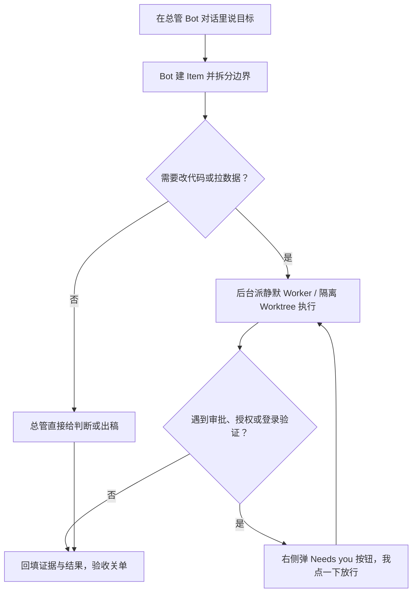

> 夫运筹策帷帐之中，决胜于千里之外。——《史记·高祖本纪》（[原文](https://zh.wikisource.org/zh-hans/史記/卷008)）

切到 Orca 试跑了 10 天（11 月 17 日至 26 日），我把手头 7 个项目收进同一个入口，陆续结单了 89 条任务。如果说以前用 [Paseo](https://geoqiao.me/blog/how-i-use-paseo/) 是把多 Agent 窗口摆成顺手的驾驶舱，那用 Orca 最大的变化，是**我不再自己当工头盯着好几个窗口来回切，而是只跟一个总管 Bot 聊天**。

> Orca = 一个跨项目总管 Bot + 右侧审批单（Items）+ 后台隐身施工队（Workers）+ 定时闹钟（Automations）

## Orca 怎么帮我干活

### 1. 只留一个主对话，右侧 Items 当审批单

以前同时推三四件事，光是找“刚才那个改动在哪个窗口”就很费神。在 Orca 里，日常绝大多数需求我都在同一个总管 Bot 对话口里说，剩下的进度全部挂到右侧的 **Items** 面板里，按状态自然分开：

- **In progress**：后台 Worker 正在干的活，不用我盯着；
- **Needs you**：卡在需要我拍板、审稿、授权推送或人工验证的地方，直接给出几个快捷按钮，点一下就继续推进；
- **Waiting / Planned**：等外部条件或排在后面的事，不用靠脑子记。

### 2. 后台静默 Worker + Worktree 隔离

总管接到任务后，不会自己一股脑全干，而是按任务边界派给后台的 **Worker**。在 Orca 里，由 Bot 派出去的 Worker 默认走 `structured` 静默后台模式——它不往左侧栏塞一堆黑框终端标签，同时跑三四个任务，工作台依然清清爽爽；涉及改代码时，再自动拉一个隔离的 Git worktree，改完测完再交给我决定要不要合并推送。

模型分工上，我还是沿用“总管拍板表达、后台稳健执行”的配合方式，具体思路前两天已经单独写过[操作笔记](https://geoqiao.me/blog/how-gemini-4-neon-uses-gpt/)和[模型思考](https://geoqiao.me/blog/boss-model-vs-worker-model-instruction-following/)，这里不展开。

### 3. Automations：把巡检和“以后的事”交给闹钟

除了随手派活，Orca 的 **Automations** 帮我清掉了两类最烦人的碎片负担：

1. **周期与事件巡检**：比如开源项目的上游依赖检查和 GitHub PR / Issue 监听，平时静默在后台看着，有实质变化才提醒；
2. **一次性未来唤醒**：碰到受平台时间窗口限制、或者约定过几天再复查的事，直接建一条一次性定时任务挂进 Waiting，到点它自己醒来接着办。

### 4. 浏览器怎么配合

凡是涉及本地前端调试和公开页轻交互，用 Orca 内置浏览器就够了；遇到需要保持登录态、或者中途要扫码/二次验证的后台，再交给 Ego Lite 在独立空间里跑，需要我动手时自动交回来，点完继续还给后台。

## 我平时怎么用

整个闭环其实非常短，平时几乎不碰底层终端命令：

## 最后：Orca 和 Paseo 怎么选

这两个工具我都喜欢，但侧重点明显不同：

- **更适合 Paseo**：如果你经常需要亲自盯代码、喜欢像 IDE 一样自由拖动多 Agent 分栏，随时看终端输出并随手插手改几行，Paseo 依然非常顺手；
- **更适合 Orca**：如果你手头同时管着好几个不同项目，已经不想再自己当工头切来切去，而是想把体验收拢成“**说清楚目标 → 点审批按钮 → 看最终验收结果**”，Orca 很值得一试。

Orca Bot 把所有底层复杂度都藏在了幕后——上面提到的隔离工作区、后台 Worker、Items 追踪和定时任务，全都不必自己一个个去配置或操作，全部交给 Bot 就行。这是 Orca 最颠覆的 UX 体验。
