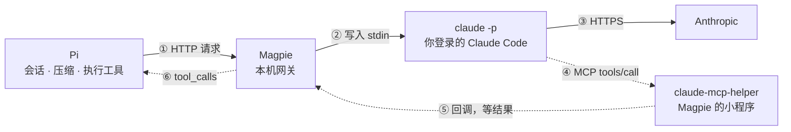

> 金风玉露一相逢，便胜却人间无数。——秦观《鹊桥仙》（[原文](https://zh.wikisource.org/zh-hans/鵲橋仙_(秦觀))）

> **Magpie 不直接调 Anthropic 的接口，而是在本机开一个用你自己订阅登录的 `claude -p`，让它替 Pi 去问。Pi 的工具包成 MCP 工具交给它，Pi 的系统提示词拼在用户的话前面，压缩和会话历史都留在 Pi。**

## 背景

我在 Pi 里写代码，模型用 Claude 订阅（配置见 [10 月的配置清单](https://geoqiao.me/blog/whats-on-my-pi-agent-october-2026/)）。

Pi 自己也能用订阅登录，但它会提示：第三方 harness 的用量走额外付费，按 token 计费，不占订阅额度。2026 年 4 月起，OpenClaw 这类工具都是这样（[TechCrunch](https://techcrunch.com/2026/04/04/anthropic-says-claude-code-subscribers-will-need-to-pay-extra-for-openclaw-support/)）。

[帮助中心](https://support.claude.com/en/articles/15036540-use-the-claude-agent-sdk-with-your-claude-plan) 2026-10-07 的更新写明：`claude -p` 仍然用订阅额度。[Magpie](https://usemagpie.ai) 的办法就是：Pi 不直接拿订阅去请求，而是交给本机的 `claude -p` 去问。



实线是请求，虚线是工具调用。

## 一、真实请求发生在哪里

**在本机的 `claude -p` 里。** Pi 把请求发给 Magpie，Magpie 不转发，而是把内容写进一个 `claude -p` 进程的标准输入。发往 Anthropic 的请求由 Claude Code 自己发出，用的是 Claude Code 的身份和你的订阅登录。

关键的启动参数：

```text
claude -p --input-format stream-json --output-format stream-json \
  --tools "" \
  --strict-mcp-config --mcp-config <只含 Magpie 的 MCP 服务>
```

- `stream-json`：进程一直开着。Magpie 往里写消息、读流式回复，再转成 Pi 认识的格式。
- `--tools ""`：Claude Code 自带的工具全部关掉。
- `--mcp-config`：只接 Magpie 给的 MCP 服务，Pi 的工具从这里进来。

## 二、Pi 的工具怎么接进 Claude

**Pi 的工具被包成一个 MCP 服务。Claude 调工具时，Claude Code 停在 MCP 调用上等；Magpie 把调用转给 Pi 执行，再把结果送回这个等着的调用。**

Magpie 把 Pi 请求里的工具清单写成文件，交给小程序 `claude-mcp-helper`。Claude Code 把它当 MCP 服务启动，所以 Claude 看到的工具名是 `mcp__magpie__read` 这样的形式。

一次调用：

1. Claude 要调 `mcp__magpie__read("a.md")`。
2. Claude Code 调用 MCP 小程序。小程序通知 Magpie，然后挂着等。
3. Magpie 去掉前缀，回给 Pi 一个普通的 `read("a.md")` 工具调用。Pi 的这次请求结束。
4. Pi 在本地读文件，下一次请求带上结果。
5. Magpie 按调用 id 找到挂着的小程序，把结果交给它。Claude 拿到结果，接着往下写。

所以 Claude 的一轮回答，可能跨了 Pi 的好几次请求。Pi 以为自己在用普通的模型接口，Claude Code 以为自己在等一个慢一点的 MCP 工具。

## 三、系统提示词怎么拼

**`system` 由 Claude Code 自己生成，Magpie 不改。Pi 的整份系统提示词拼在用户的话前面。工具定义走 MCP，进 `tools`。**

按 Anthropic 文档，工具定义排在系统提示词前面，缓存前缀也按 `tools` → `system` → `messages` 的顺序。一次请求从上到下：

```text
tools      Pi 的工具定义（名字、说明、参数），加 mcp__magpie__ 前缀
system     Claude Code 的系统提示词，Magpie 不改：
             计费头    x-anthropic-billing-header: cc_version=…; cc_entrypoint=sdk-cli;
             身份句    You are a Claude agent, built on Anthropic's Claude Agent SDK.
             主提示词  行为规则，部分模型多出专有的段落
messages
  user     API 里算一条用户消息，但只有最后的 Human 才是用户说的：
             <system-reminder>               Claude Code 自动附上的上下文
             <external_system_instructions>  Magpie 拼进来的 Pi 系统提示词
               开头一句身份说明
               <tools>            每个工具一行简介
               <rules>            工具的使用规则
               <docs>             Pi 文档的位置
               <addendum>         APPEND_SYSTEM.md
               <project_context>  AGENTS.md
               <skills>           技能列表
               <cwd>              项目目录
               扩展和外部工具追加的文字
             </external_system_instructions>
             Human: 用户的问题               ← 这才是用户消息
  system   Claude Code 加的环境信息：工作目录、平台、模型、日期
```

## 四、压缩怎么实现

**Claude Code 的自动压缩关掉了，压缩全由 Pi 做。压缩后的对话，Magpie 交给一个新的 `claude -p`，把历史写成文字发过去。**

Pi 的做法：上下文快满时（或手动 `/compact`），保留最近约 2 万 token，更早的部分另发一个请求让模型总结。之后每次请求发的是：系统提示词 + 摘要 + 保留的消息。

到了 Magpie，消息列表的开头变了，原来那个 Claude Code 进程对不上（见下一节）。Magpie 新开一个 `claude -p`，第一条消息写成：

```text
<external_system_instructions>…</external_system_instructions>

<conversation_history>
Human: （Pi 的摘要）
Assistant: 我先读一下文件。
[tool call mcp__magpie__read id=… args={"path":"a.md"}]
Human: [tool result id=…] 文件内容……
</conversation_history>

<current_turn>
Human: 新的一句
</current_turn>
```

旧的工具调用变成了文字行，只是记录，不会被当成真的调用。开头那段（Claude Code 提示词、工具定义、Pi 系统提示词）没变，还能读缓存。我这个会话压缩了三次，每次之后都读到 21,815 个缓存 token，只有摘要和保留的消息要重写。

## 五、历史对话怎么继续

**Pi 每次都发完整历史。Magpie 按历史算指纹，找到还开着的那个 Claude Code，只把新消息写进去；找不到才把整段历史重讲一遍。**

HTTP 请求没有状态，Pi 每次都把系统提示词、全部消息和工具发一遍。Magpie 用这些算一个指纹（`turnKey`），依次试三条路：

| | 什么时候 | 怎么做 | 缓存 |
|---|---|---|---|
| 1 | 上一轮的 Claude Code 还开着（最多等 1 小时） | 只把新消息写进它的 stdin | 之前的全部命中 |
| 2 | 进程被挤掉了，会话文件还在 | `claude -p --resume`，只发新消息 | 同样命中 |
| 3 | 都没有：刚压缩、换了模型或工具、隔了 1 小时以上 | 新开 `claude -p`，整段历史写成文字（上一节的格式） | 只命中开头那段 |

正常聊天一直走第 1 条。我这个会话 118 次请求，95.5% 的输入读自缓存。

Claude Code 的进程和会话文件都是临时的，闲置一小时后清掉。真正的历史只在 Pi 的会话文件里，所以 `/resume`、`/tree`、`/compact` 都在 Pi 里做。

## 结论

**`claude -p` 逻辑上符合 Anthropic 的政策：Pi 可以用 Claude 订阅，会话也统一由 Pi 管。**

- [帮助中心](https://support.claude.com/en/articles/15036540-use-the-claude-agent-sdk-with-your-claude-plan) 2026-10-07 的更新写明：仍然可以用订阅额度跑 `claude -p`。
- [Claude Code 合规页](https://code.claude.com/docs/en/legal-and-compliance)禁止第三方经手订阅凭据、替用户转发请求，但不妨碍用户用自己的订阅登录未修改的 Claude Code。
- Magpie 正是这样：运行本机没改过的 `claude`，登录走 `claude auth login`，令牌留在 Claude Code 里，请求由 Claude Code 发出。

> 基于 Magpie 2026-10-25 的源码（提交 `2c7f0ac1`）和 Pi 1.2.0。
