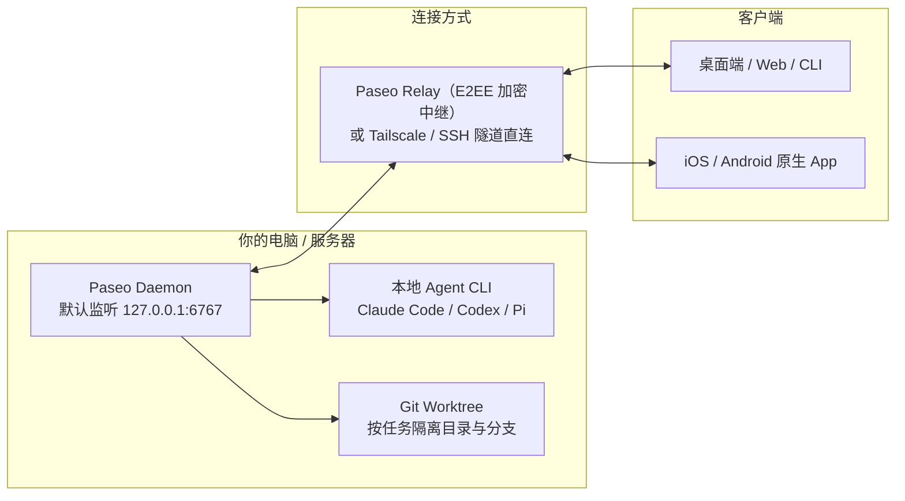

> 莫听穿林打叶声，何妨吟啸且徐行。——苏轼《定风波》（[原文](https://zh.wikisource.org/wiki/%E5%AE%9A%E9%A2%A8%E6%B3%A2(%E8%8E%AB%E8%81%BD%E7%A9%BF%E6%9E%97%E6%89%93%E8%91%89%E8%81%B2))）

**Paseo**（官网 [paseo.sh](https://paseo.sh/)，开源仓库 [getpaseo/paseo](https://github.com/getpaseo/paseo)）是一款本地优先、自托管的开源 AI 编程 Agent 统一工作台（Agentic Development Environment）。它本身不是大模型，也不卖模型额度，而是套在 Claude Code、Codex、Pi、OpenCode、GitHub Copilot 等底层 CLI Agent 外层的调度和远程控制层。

| 维度 | Paseo（paseo.sh）核心事实 |
| --- | --- |
| **架构** | 本地 Daemon 服务 + 桌面端 / Web / CLI / iOS / Android 客户端 |
| **并行隔离** | 原生支持 Git Worktree，多个 Agent 各改各的分支不互相踩文件 |
| **远程访问** | 可选端到端加密中继 `paseo-relay`（默认关闭），也支持 Tailscale 或 SSH 隧道直连 |
| **支持 Agent** | 复用本地已安装的 Claude Code、Codex、Pi、OpenCode、Copilot 等 CLI |
| **费用与隐私** | 软件开源免费自托管，无强制登录；实际开销取决于你自己的模型订阅或 API |

先交代一下本文的经验边界：我从 2026 年 8 月起试过六款桌面编排工具后把 Paseo 当主力用了大约三个月，顺手写了 [paseo-stuff](https://geoqiao.me/projects/paseo-stuff/) 和 [pi-tools](https://geoqiao.me/projects/pi-tools/) 两套小插件，11 月下旬才把多项目总管派活切到 Orca。文中的日常使用、Agent Profile 分工、手机跟进和 Paseo vs Orca 判断来自我的真实使用；Docker 容器部署和部分排错参数我本人未长期重度实测，这部分均按 2026 年 11 月 `getpaseo/paseo` 官方文档如实核对整理。

---

## 一、Paseo 解决什么问题？

只开一个命令行 Agent 写代码时，终端本身够用。但只要同时推两三个任务，或者离开电脑还想看进度，纯终端很快会遇到三个烦人的问题：

1. **多窗口切来切去**：一边改功能、一边查资料、一边看 diff，终端和编辑器来回切，过半小时就忘了哪个窗口跑着什么。
2. **同仓库并行容易撞车**：两个 Agent 同时改同一个目录，文件互相覆盖、Git 状态乱成一团。
3. **人一离桌任务就卡住**：Agent 跑到一半停下来等你确认权限或补一句说明，人不在电脑前就只能干等。

Paseo 的做法类似 Docker 的客户端-服务端架构：本机跑一个 **Daemon** 负责拉起并管理你本地的各种 Agent CLI，外面提供桌面端、Web、CLI 和原生 iOS/Android 客户端连接这个 Daemon，把多 Agent 分栏、文件编辑器、diff、终端和内置浏览器收进一个窗口。



---

## 二、安装前准备：前置条件检查

Paseo 不内置大模型，也不自带第三方 Agent CLI，它启动的是你本机已经装好的工具并沿用你的登录凭据。装 Paseo 之前先确认两件事：

1. **至少装好并登录一个底层 Agent CLI**，且在全新打开的终端里能直接运行，例如：
   - [Claude Code](https://docs.anthropic.com/en/docs/claude-code)（`claude`）
   - [Codex](https://github.com/openai/codex)（`codex`）
   - [Pi](https://pi.dev)（`pi`）
   - [OpenCode](https://github.com/anomalyco/opencode) / [GitHub Copilot CLI](https://github.com/features/copilot/cli/) / Cursor / Gemini CLI 等（完整列表见官方 [Supported providers](https://paseo.sh/docs/supported-providers)）
2. **备好 Git**：并行跑任务依赖 Git Worktree；如果希望 Agent 直接在工作台里提 PR，顺手把 GitHub CLI（`gh`）装好并登录。

---

## 三、Paseo 怎么安装：桌面端、CLI 与 Docker

按你跑 Agent 的机器形态选一种就行。个人电脑直接装桌面端最省事；无界面服务器或远程开发机选 CLI 或 Docker。

### 1. 桌面端安装（macOS / Windows / Linux，新手首选）

直接到 [paseo.sh/download](https://paseo.sh/download) 或 [GitHub Releases](https://github.com/getpaseo/paseo/releases) 下载对应系统的安装包。打开桌面应用后，本地 Daemon 会自动启动，不用单独敲命令或管后台进程。

### 2. CLI 安装（适合无界面开发机 / VPS）

如果你要在远程 Linux 服务器、虚拟机或无桌面环境里跑 Daemon，用 npm 安装官方 CLI：

```bash
npm install -g @getpaseo/cli
paseo
```

首次运行 `paseo` 启动 Daemon 时，会交互式询问是否启用端到端加密 Relay 以便手机配对。如果你不打算走官方中继，选否即可，后续用 SSH 隧道或 Tailscale 直连。桌面端、手机端和 Web 端都可以像连本机一样接入这台远端主机。

### 3. Docker 自托管部署（适合 NAS / Homelab / 云服务器）

官方镜像 `ghcr.io/getpaseo/paseo:latest` 同时打包了 Daemon 和自托管 Web UI，默认以非 root 的 `paseo` 用户监听容器内 `6767` 端口：

```bash
docker run -d --name paseo \
  -p 6767:6767 \
  -e PASEO_PASSWORD=change-me \
  -v "$PWD/paseo-home:/home/paseo" \
  -v "$PWD:/workspace" \
  ghcr.io/getpaseo/paseo:latest
```

启动后在浏览器打开 `http://localhost:6767`（设置了 `PASEO_PASSWORD` 时在连接界面填入同一密码）。

有一个官方文档特别提醒的坑：**官方基础镜像不包含任何第三方 Agent CLI**，目的是减小镜像体积、避免和各家 CLI 版本绑死。实际在容器里跑任务，需要基于基础镜像建一个子 `Dockerfile` 把你要用的 CLI 装进去，再通过环境变量或持久化的 `/home/paseo` 卷保留登录态：

```dockerfile
FROM ghcr.io/getpaseo/paseo:latest

USER root
RUN npm install -g @openai/codex @anthropic-ai/claude-code
```

完整 Compose 示例与更新说明见官方 [Docker 文档](https://paseo.sh/docs/docker)。

---

## 四、5 分钟跑通第一条任务：Worktree 并行与常用 CLI 命令

### 在桌面端跑第一条任务

1. 打开 Paseo，添加你的本地项目目录作为 Workspace。
2. 新建一个 Agent 面板，选好你本机已登录的 Provider 和模型（例如 Claude Code、Codex 或 Pi）。
3. 如果希望主 Agent 能自动拆分任务、拉起其他子 Agent，先到 **Settings → Agent → Enable Paseo Tools** 打开 Paseo 工具开关。
4. 像在聊天窗口里一样说清目标、改动范围和验收方式；需要同时推第二件事时，新建一个带 **Git Worktree** 隔离的 Agent，两个任务各自在独立工作目录和分支里改代码，不会互相污染，跑完直接在右侧看 diff 决定合并哪一个。

### 常用 CLI 命令速查

桌面端里能做的事，命令行也都能调（适合脚本化或远程连服务器）：

| 命令 | 作用 |
| --- | --- |
| `paseo run --provider claude/opus-4.6 "实现登录接口"` | 用指定 Provider 和模型启动一条任务 |
| `paseo run --provider codex/gpt-5.5 --worktree feat-auth "实现登录接口"` | 在名为 `feat-auth` 的独立 Git Worktree 里跑任务 |
| `paseo ls` | 列出当前运行中的 Agent 及其 ID |
| `paseo attach <id>` | 实时跟踪某个 Agent 的输出流 |
| `paseo send <id> "顺手补上单元测试"` | 给正在运行或等待中的 Agent 追加指令 |
| `paseo logs <id>` / `paseo stop <id>` | 查看时间线日志 / 停止指定 Agent |
| `paseo --host ssh://user@host ls -a` | 通过本机 OpenSSH 隧道操作远端主机上的 Daemon |
| `paseo run --host workstation.local:6767 --cwd /workspace "运行全量测试"` | 向指定远端 Daemon 下发任务（`--cwd` 为远端路径） |
| `paseo provider diagnostic <provider>` | 诊断 Daemon 实际看到的 `PATH` 和 CLI 版本 |

更多子命令与 `host` / `usage` 脚本参数见官方 [CLI 文档](https://paseo.sh/docs/cli)。

---

## 五、手机远程控制：iOS / Android 配对与 Paseo Relay

手机远程接管是 Paseo 最让我省心的地方。人离开工位后，不用远程桌面硬搓小屏，直接看 Agent 进度、点权限放行、补一句修改意见，甚至语音口述需求。

### 1. iOS 与 Android 客户端安装

在 [paseo.sh/download](https://paseo.sh/download) 可以直接跳转到 **App Store（iOS）** 和 **Google Play（Android）** 下载原生客户端。手机端不是只能看日志的精简版，它和桌面端共用同一套协议和插件界面，能同时绑定多台电脑或服务器（比如一台工作机、一台个人机）。

### 2. 扫码配对步骤

根据你在主机上用桌面端还是 CLI，选对应方式生成配对二维码：

- **桌面端配对**：打开 **Settings → 你的主机 → Devices → Relay**，开启 **Enable relay** 后页面会出现二维码和配对链接；打开手机端 Paseo，扫码或点 **Paste pairing link** 粘贴链接即可完成绑定。
- **CLI 配对**：在运行 Daemon 的主机终端执行：

```bash
paseo daemon pair
```

确认提示后（加 `--relay` 可跳过交互确认），终端会直接打印二维码和 `https://app.paseo.sh/#offer=...` 配对链接，手机扫码或粘贴即可。

### 3. 外网怎么连？Paseo Relay（E2EE 加密中继）与直连方案

外网手机连家里或公司的电脑，传统做法要自己折腾内网穿透、端口映射或 VPN。Paseo 的做法是提供一个**默认关闭、按需开启**的开源加密中继（[getpaseo/paseo-relay](https://github.com/getpaseo/paseo-relay)）：

- **端到端加密（E2EE）**：Daemon 首次运行时会在 `$PASEO_HOME/daemon-keypair.json` 生成 Curve25519 密钥对。配对链接里的公钥放在 URL `#` 后面的 fragment 里（浏览器不会把 fragment 发给服务器）。连接建立时，客户端与 Daemon 做 **Noise NK 握手**（`X25519` + `ChaCha20-Poly1305` + `SHA-256`），后续所有消息端到端加密。中继服务器只能看到 IP、连接时间和包大小，读不到你的代码和对话；如果设了 `PASEO_PASSWORD`，密码也是在加密信道里校验。
- **不走公共中继的替代方案**：如果你公司网络不允许走外部中继，或者就是更放心直连，可以在 **Settings → 你的主机 → Devices** 打开 **Tailscale**，手机端用 **Add host → Direct connection** 填 Tailscale IP 和端口直连；桌面端和 CLI 还支持免配中继的 OpenSSH 隧道（`ssh://user@host`）；有运维能力也可以按 [getpaseo/paseo-relay](https://github.com/getpaseo/paseo-relay) 自己搭一个私有中继。

我自己在 4G/5G 外网切着两台机器用了几个月，没有遇到过无故断连的情况，日常体验很接近把电脑里的工作台装进了口袋。

---

## 六、Geo 的一手使用经验：多模型分工、插件与工具取舍

前面是通用上手路径，下面三点是我用下来最影响实际体验的取舍。

### 1. 用 Agent Profile 做多模型分工

我日常底层主要用原版 **Pi**（极简底座、按需装插件，细节写在 [Pi Agent 配置清单（2026-10）](https://geoqiao.me/blog/whats-on-my-pi-agent-october-2026/)），再搭配 Claude Code 和 Codex。Paseo 的 **Agent Profile** 允许你给不同职责预设不同的 Harness、模型和推理档位。我的习惯是**小事主 Agent 直接做，值得拆的时候再派子 Agent**：

- 日常讨论与拆解交给主力模型；
- 查代码、读日志这种只读检索交给便宜快速的档位；
- 边界清晰的常规编码单独分出去跑，替主力省订阅额度；
- 遇到关键设计或高风险改动，再拉另一套 Harness 的模型做独立复核，避免同一种思路的盲点。

具体的 Profile 分档、界面布局和手机跟进验收闭环，我单独记录在 [Paseo 进阶实战：多 Agent 分工、Profile 配置与手机远程验收](https://geoqiao.me/blog/how-i-use-paseo/) 里，这里不重复展开。

### 2. 内置编排 Skills 与我维护的社区插件

- **官方编排 Skills**：Paseo 提供 `/paseo`（基础参考）、`/paseo-handoff`（带上下文移交任务）、`/paseo-advisor`（请另一个 Agent 给第二意见）和 `/paseo-committee`（双 Agent 独立分析难题）。在 **设置 → 主机 → 工具与提示词 → Paseo skills** 开启，或在终端执行 `npx skills add getpaseo/paseo` 安装。按我自己的习惯，平时更多直接靠 Profile 委派，很少手动敲这些斜杠命令。
- **我维护的社区插件**：注意 Paseo 插件运行在 Daemon 侧且**不受沙箱限制**，安装任何社区插件前都建议先看源码。我围绕自己踩过的显示和交互痛点维护了两套开源仓库：
  - [paseo-stuff](https://geoqiao.me/projects/paseo-stuff/)（[GitHub](https://github.com/geoqiao/paseo-stuff)）：包含把官方 DeepSeek Harness CLI 接进 Paseo 的 `DeepSeek Harness`、渲染行内与块级 LaTeX 公式的 `Math Renderer`，以及高亮折叠工具 JSON 输出的 `Readable Agent Activity`。需要时可直接通过官方注册表安装，例如 `paseo plugin add geoqiao/deepseek-harness` 或 `paseo plugin add geoqiao/math-renderer`。
  - [pi-tools](https://geoqiao.me/projects/pi-tools/)（[GitHub](https://github.com/geoqiao/pi-tools)）：目前持续维护的核心包是 `@geoqiao/pi-ask`（`pi install npm:@geoqiao/pi-ask`），让 Pi 在 Paseo 的 RPC 模式下也能弹出结构化单选/多选提问；同仓库早期的 `paseo-btw`、`pi-usage` 等包已停止维护。

### 3. Paseo 和 Orca 怎么选？

8 月横向试用 6 款桌面 Agent 编排工具时，我最终留在了 Paseo（过程见 [6 款 AI Agent Orchestrator 对比](https://geoqiao.me/blog/agent-orchestrator-desktop-selection/)）。11 月下旬我重测了 Orca，发现两者的交互哲学已经明显分化（详细记录见 [我如何使用 Orca](https://geoqiao.me/blog/how-i-use-orca/)）：

| 对比维度 | Paseo | Orca |
| --- | --- | --- |
| **核心交互范式** | 多 Agent 驾驶舱：自由拖动分栏，随时看终端、改文件、看 diff | 总管 Bot + 审批单（Items）：只跟一个总管对话，后台静默派 Worker |
| **代码介入感** | 强，适合边盯代码边随时插手改几行 | 弱，偏向“说清目标 → 点 Needs you 审批 → 验收结果” |
| **多项目与定时任务** | 多 Workspace + 多主机切换，支持内置调度 | 跨多项目收口极省心，自带 Automations 周期巡检与一次性定时唤醒 |
| **手机远程与多机** | 原生 iOS/Android App + E2EE Relay，体验非常成熟 | 桌面端总管流程优先，跨端体验不如 Paseo 轻便 |
| **更适合谁** | 喜欢 IDE 式自由分栏、重度依赖手机远程和 Pi 插件的人 | 同时管多个项目、不想再手动切十几个窗口当工头的人 |

如果你只用 Claude Code 或 Codex、最看重极简颜值而不看重 Pi 支持，也可以顺带看看 T3 Code 或 Codex Desktop。

---

## 七、常见问题与排错（FAQ）

### Q1：Paseo 免费吗？需要额外买 API 吗？
Paseo 本身开源免费，本地自托管不收月费。它不提供模型推理，消耗的是你本机已登录的 Claude Code、Codex、Pi 等 Agent 对应的订阅额度或 API 费用。

### Q2：明明装了 Claude Code / Codex / Pi，为什么 Paseo 显示“未安装”？
这是 macOS 和 Linux 上最常见的问题：从图标打开桌面应用时，系统给的环境变量比终端精简，用 `nvm`、`mise`、`asdf` 等版本管理器装的 CLI 经常不在默认 `PATH` 里。

排查和修复分两步：
1. 在终端运行 `paseo provider diagnostic <provider>`（或在 **设置 → 你的主机 → Providers** 点 **诊断报告**），对比 **Daemon PATH** 和全新终端里的 `echo $PATH`。
2. 治本做法是把版本管理器初始化写进普通登录 shell 配置（如 `.zshrc` / `.zprofile`）再重启 Paseo；如果想直接固定路径，可以在 `~/.paseo/config.json` 的 `agents.providers.<id>.command` 里填入 `which -a <cli>` 查到的真实二进制绝对路径，然后运行 `paseo reload` 生效。

### Q3：手机端在 4G/5G 外网连不上本地电脑怎么办？
按顺序查四处：
1. 电脑是不是休眠了（合盖断网后 Daemon 无法响应，远程用需要保持主机在线或部署在常开机器/服务器上）；
2. 在主机运行 `paseo daemon status` 确认服务活着，报错日志看 `~/.paseo/daemon.log`；
3. 确认已经在桌面端 **Devices → Relay** 或 `paseo daemon pair` 里启用了 Relay，且若设置了 `PASEO_PASSWORD`，手机端输入的密码一致；
4. 若升级后遇到握手拒绝，把桌面端/Daemon 和手机 App 更新到同一大版本。

### Q4：Paseo 支持 Windows、Linux 和 Android 吗？
支持。桌面端覆盖 macOS、Windows 和 Linux，手机端有原生 iOS 和 Android 应用，全部入口在 [paseo.sh/download](https://paseo.sh/download)。Linux 用户运行 AppImage 如果遇到 `error loading libfuse.so.2` 报错，可以加参数 `./Paseo-x86_64.AppImage --appimage-extract-and-run` 启动，或改用 `.deb` / `.rpm` 包。

### Q5：新手现在该先装 Paseo，还是直接用 Orca？
看你平时怎么和 AI 写代码：如果当前主要聚焦一两个仓库，想亲眼看着改动、随时切分栏编辑、并且经常在手机上远程跟进，先装 **Paseo**；如果手上同时挂着四五个项目，只想把派活和巡检交给一个总管 Bot、自己只负责拍板验收，直接看 [Orca 的用法](https://geoqiao.me/blog/how-i-use-orca/)。
